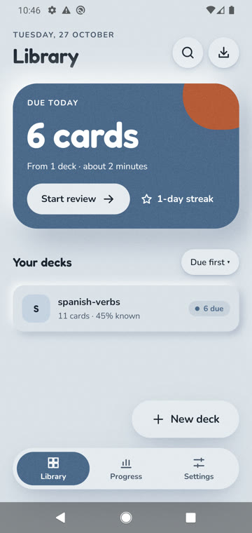
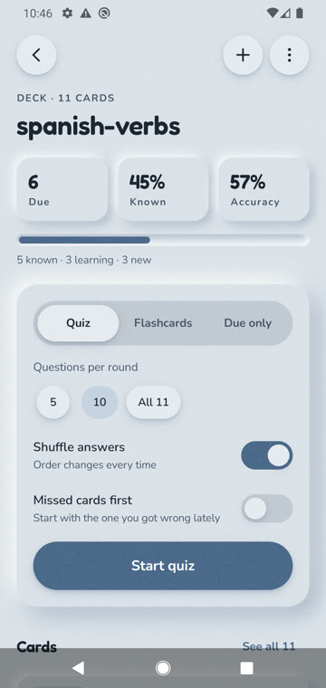
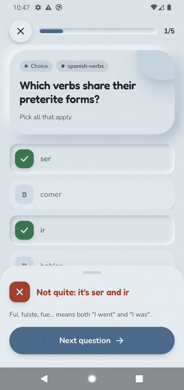
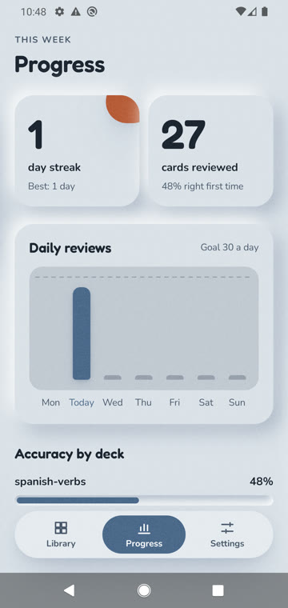
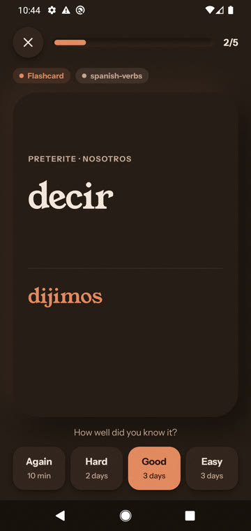
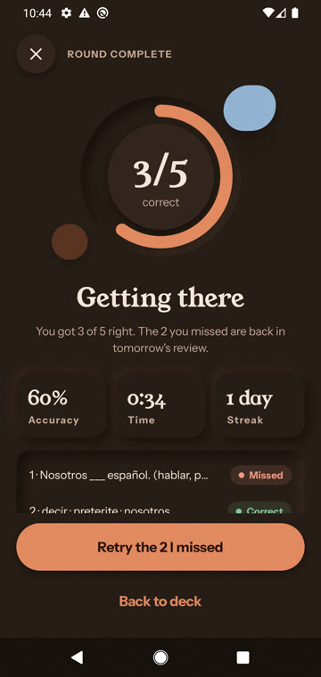
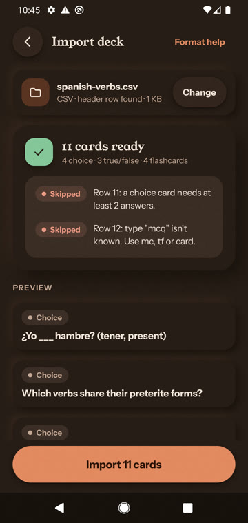
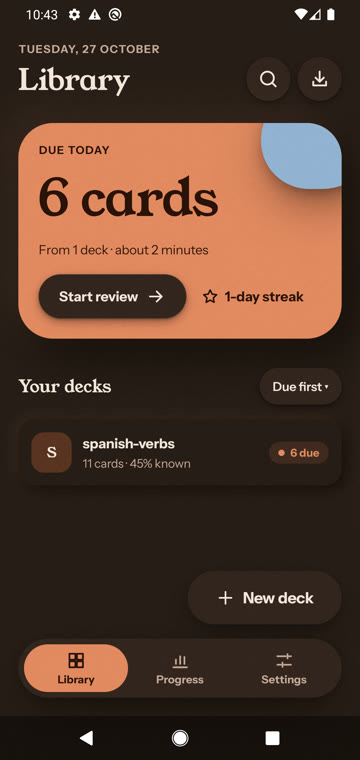

# Recall

Recall is an offline study app for Android. You build decks of quiz cards and flashcards by hand or import them from CSV or JSON, then study them with spaced repetition. It has no accounts and makes no network calls. All data stays on the device and can be backed up to and restored from a single JSON file.

<p>
  
  
  
  
</p>
<p>
  
  
  
  
</p>

## Download

Get the APK from the [latest release](https://github.com/mverhoeff/recall/releases/latest) and open it on your phone. Android asks once to allow installs from your browser or file manager, since the app doesn't come from the Play Store.

Requires Android 10 or newer.

## Features

- Three card types: multiple choice (with one or several right answers), true/false and flashcards
- Spaced repetition: cards you know come back less often, missed ones come back tomorrow
- Quiz and flashcard rounds, a review of everything due, and a retry of the cards you missed
- Import decks from CSV or JSON, with a preview that shows skipped rows and why
- Backup and restore of all decks, progress and settings as one JSON file
- Weekly progress with a streak, daily reviews against a goal you set, and accuracy per deck
- An optional daily reminder, only when cards are due
- Four colour palettes, light and dark, three type pairings and a reduce-motion setting

## Privacy

Recall has no internet permission, no accounts and no analytics. The only permission it asks for is notifications, for the daily reminder.

## Importing decks

A CSV deck has the column names in the first row, in any order, and one card per row after that:

```csv
type,prompt,answer,wrong1,wrong2
mc,Capital of Australia?,Canberra,Sydney,Melbourne
tf,Rome is the capital of Italy.,true
card,Japan · capital,Tokyo
```

| Column | |
|---|---|
| `type` | `mc` for choice, `tf` for true/false, `card` for a flashcard |
| `prompt` | The question, statement or front of the card |
| `answer` | The right answer, or `true` / `false` |
| `wrong1` – `wrong5` | Wrong options for a choice card (optional) |
| `answer2` – `answer5` | More right options for a choice card (optional) |
| `explanation` | Shown after answering (optional) |

Decks exported from Recall and Recall backups import as they are. `docs/samples/` has example decks in CSV and JSON.

## Building

Requires Android Studio's bundled JDK (17 or newer) and the Android SDK.

| What | Command |
|---|---|
| Build debug APK | `./gradlew :app:assembleDebug` |
| Build release APK | `./gradlew :app:assembleRelease` |
| Unit tests | `./gradlew :app:testDebugUnitTest` |
| Instrumented tests | `./gradlew :app:connectedDebugAndroidTest` |
| Install and launch | `./gradlew :app:installDebug && adb shell am start -n com.recall/.MainActivity` |
| Lint | `./gradlew :app:lintDebug` |

## Design

Kiln (matte claymorphism), see `docs/design`.
